# Task 2 项目地图：工具调用升级

> 这张图按“理论学习 -> 环境准备 -> 三个递进项目 -> 测试验收 -> GitHub 记录”的路线展示整个 Task 2。可在支持 Mermaid 的 Markdown 查看器或 GitHub 中渲染。

```mermaid
flowchart TB
    T2(["Task 2：工具调用升级"])

    T2 --> THEORY["一、理论学习"]
    T2 --> ENV["二、环境准备"]
    T2 --> PROJECTS["三、项目实践：能力逐级升级"]
    T2 --> TEST["四、测试与验收"]
    T2 --> GITHUB["五、GitHub 工作流"]

    THEORY --> TH1["ReAct：Thought → Action → Observation"]
    THEORY --> TH2["工具选择与参数解析"]
    THEORY --> TH3["检索结果与上下文"]
    THEORY --> TH4["多轮状态与最大步数"]

    ENV --> E1["Python 依赖"]
    ENV --> E2["Ollama 服务"]
    ENV --> E3["本地模型：qwen2.5:3b"]
    ENV --> E4["本地测试数据与隔离工作区"]

    PROJECTS --> P1["项目 1：Markdown 文档问答 Agent\n状态：实现、测试与运行验证完成"]
    P1 --> P1A["递归扫描 .md 笔记"]
    P1 --> P1B["字符级 TF-IDF 相似度检索"]
    P1 --> P1C["Action: search_notes"]
    P1 --> P1D["Observation 回填后基于笔记回答"]

    P1 --> P2["项目 2：本地待办管理 Agent\n状态：实现、9 项测试与四类操作验证完成"]
    P2 --> P2A["add_todo：新增"]
    P2 --> P2B["list_todos：查询"]
    P2 --> P2C["update_todo：修改"]
    P2 --> P2D["delete_todo：删除"]
    P2 --> P2E["JSON 持久化与多工具路由"]

    P2 --> P3["项目 3：多步骤文件批处理 Agent\n状态：6 项测试与真实运行验证完成"]
    P3 --> P3A["列出并读取工作区文件"]
    P3 --> P3B["筛选目标段落"]
    P3 --> P3C["汇总并写入新 Markdown"]
    P3 --> P3D["Harness 控制多步流程，模型负责总结"]
    P3 --> P3E["工作区路径限制与步数上限"]

    TEST --> TST1["正常流程与工具结果正确"]
    TEST --> TST2["空数据、无匹配和错误参数"]
    TEST --> TST3["模型格式错误与工具异常"]
    TEST --> TST4["多步任务失败恢复与步数上限"]
    TEST --> TST5["真实 Ollama 运行并记录 RESULTS.md"]

    GITHUB --> G1["Issue / 任务记录"]
    GITHUB --> G2["创建 feature 分支"]
    GITHUB --> G3["逐项目 add / commit / push"]
    GITHUB --> G4["Pull Request 与检查"]
    GITHUB --> G5["合并 main、同步并打版本标签"]

    classDef root fill:#2457d6,color:#fff,stroke:#1742a5,stroke-width:2px
    classDef section fill:#e7efff,color:#173b82,stroke:#7196e8,stroke-width:1.5px
    classDef theory fill:#e3f5e8,color:#23643a,stroke:#69bd7d
    classDef env fill:#fff2d1,color:#805200,stroke:#e5b84d
    classDef project fill:#eaf2ff,color:#183e83,stroke:#77a2ef
    classDef done fill:#ddf5e5,color:#1d6339,stroke:#59b976
    classDef pending fill:#fff0d8,color:#805200,stroke:#e4b44c
    classDef check fill:#e9f3ff,color:#204e8a,stroke:#78a6e8
    classDef github fill:#f1eaff,color:#563a88,stroke:#a789d6

    class T2 root
    class THEORY,ENV,PROJECTS,TEST,GITHUB section
    class TH1,TH2,TH3,TH4 theory
    class E1,E2,E3,E4 env
    class P1,P1A,P1B,P1C,P1D,P2,P2A,P2B,P2C,P2D,P2E,P3,P3A,P3B,P3C,P3D,P3E done
    class TST1,TST2,TST3,TST4,TST5 check
    class G1,G2,G3,G4,G5 github
```



**项目递进关系：**本地笔记检索（获取信息） -> 待办多工具调度（选择并执行操作） -> 文件批处理（固定 Harness 控制多步工具流程并由模型总结）。三个项目均已实现并完成运行验证；项目 1 有 10 项测试通过，项目 2 有 9 项测试通过，项目 3 有 6 项测试通过。Task 2 GitHub 记录尚未完成。

## 1. Task 2 总目标

Task 2 在 Task 1 的 ReAct 基础上逐步升级 Agent 能力：先查询本地知识，再从多个工具中选择并执行，最后连续调用工具完成多步骤任务。

```text
Task 1：单个工具的 ReAct 基础
    -> Task 2 项目 1：本地 Markdown 检索
    -> Task 2 项目 2：多工具待办调度
    -> Task 2 项目 3：多步骤文件处理
```

核心学习路线：

```text
查资料  ->  选择工具并做事  ->  拆解任务并连续执行
```

## 2. 建议项目目录树

```text
tasks/task-2-tool-agents/
├── AGENT学习第2次.md
├── Task2项目地图.md
└── projects/
    ├── markdown-qa-agent/
    │   ├── main.py
    │   ├── notes/
    │   │   └── 示例笔记.md
    │   ├── tests/
    │   │   └── test_main.py
    │   ├── README.md
    │   └── RESULTS.md
    │
    ├── todo-agent/
    │   ├── main.py
    │   ├── data/
    │   │   └── todos.json
    │   ├── tests/
    │   │   └── test_main.py
    │   ├── README.md
    │   └── RESULTS.md
    │
    └── file-batch-agent/
        ├── main.py
        ├── agent_workspace/
        │   └── 示例输入文件.md
        ├── output/
        │   └── （Agent 生成的结果文件）
        ├── tests/
        │   └── test_main.py
        ├── README.md
        └── RESULTS.md
```

说明：这是建议的规划结构，不代表这些目录和文件都已经创建。每个项目至少应有入口代码、测试、README 和实验结果记录。数据目录和工作目录仅供对应项目使用。

## 3. 三个项目的职责和学习重点

### 项目一：本地 Markdown 文档问答 Agent

**目标：**让模型根据本地 Markdown 笔记回答问题，而不是只依赖模型自身已有知识。

**主要流程：**

```text
用户问题
  -> 判断是否需要查询本地笔记
  -> 扫描并读取 Markdown 文件
  -> 根据文本相似度检索相关内容
  -> 将检索结果作为 Observation
  -> 模型基于检索内容回答
```

**主要工具：**

- `load_notes(folder)`：扫描目录并读取 `.md` 文件。
- `search_relevant_notes(question, notes)`：查找与问题相关的笔记内容。

任务示例使用 TF-IDF 和余弦相似度做简单检索。Agent 负责决定是否检索；检索工具负责实际查找；模型应基于 Observation 回答，不能把猜测说成笔记内容。

**重点学习：**本地文件数据如何进入 Agent 上下文，以及检索结果如何影响最终回答。

### 项目二：本地待办管理 Agent

**目标：**让模型根据用户意图从多个工具中选择一个，并为工具提供正确参数。

**预期工具：**

- `add_todo(content, time)`：新增待办。
- `list_todos()`：查看待办。
- `update_todo(todo_id, ...)`：修改待办。
- `delete_todo(todo_id)`：删除待办。

**主要流程：**

```text
用户指令
  -> 判断意图
  -> 选择工具并提取参数
  -> Python 执行待办操作
  -> 保存本地数据
  -> 将执行结果作为 Observation
  -> 模型向用户反馈
```

待办数据可以保存为本地 JSON 文件。操作结果应由 Python 工具执行后产生，再反馈给模型。

**重点学习：**从“只会调用一个检索工具”升级到“根据不同意图选择多个工具并传参”。

### 项目三：本地多步骤文件批处理 Agent

**目标：**让 Agent 把复杂任务拆成多个行动，利用每一步的执行结果继续完成后续步骤。

示例任务：

> 扫描工作目录中的 Markdown 笔记，找出包含“Agent”的段落，整理并写入新的学习总结文件。

**可能的执行步骤：**

```text
列出文件
  -> 逐个读取文件
  -> 筛选符合条件的段落
  -> 汇总内容
  -> 写入新的 Markdown 文件
  -> 检查结果并结束
```

每一步的工具结果都要记录为 Observation。当前实现由 Python Harness 固定控制列文件、读取、筛选和写入顺序，模型基于收集到的片段生成总结；这是为避免小模型跳步或重复调用而采用的受控多步流程。文件操作限制在专用工作目录内。

**重点学习：**从单轮工具选择升级到多轮推理、多步串行执行和跨步骤状态管理。

## 4. 能力递进图

| 阶段 | Agent 能力 | 典型过程 | 本阶段重点 |
|---|---|---|---|
| 项目一：Markdown 问答 | 本地知识检索 | 扫描 -> 检索 -> 回答 | 让 Agent 使用私有数据 |
| 项目二：待办管理 | 多工具调度 | 识别意图 -> 选择工具 -> 传参执行 | 工具选择、参数解析、数据持久化 |
| 项目三：文件批处理 | 多步骤执行 | 拆解 -> 多次行动 -> 汇总 -> 写入 | 多轮控制、历史状态、任务完成判断 |

```text
单工具基础
   -> 检索工具：获取外部信息
   -> 多个待办工具：根据意图选择操作
   -> 多步骤文件工具：连续执行并使用中间结果
```

## 5. 每个项目的通用验收清单

- 有独立项目目录和清晰的运行说明。
- 工具由 Python 实际执行，模型不能伪造工具结果。
- 模型输出有明确协议，并在程序中解析和校验。
- 工具执行结果或错误会作为 Observation 回传。
- 有最大执行步数，避免 Agent 无限循环。
- 自动化测试覆盖正常输入和错误情况。
- 真实 Ollama 运行结果如实写入 `RESULTS.md`。
- 文件类工具限制在明确的项目工作目录内。
- `README.md` 说明项目目标、安装、运行、工具和已知问题。

## 6. 任务说明示例中的待补项

### 待办管理 Agent

Task 2 要求新增、删除、查询、修改四类待办操作，但示例代码只展示新增、查询和标记完成。实施时需要明确“修改”的字段和行为，并补充删除工具及对应测试。

### 文件批处理 Agent

示例任务要求读取 Markdown 内容、筛选段落并写入总结；示例工具描述主要列出文件、移动、重命名和获取大小。要真正完成示例任务，还需要读取文件内容、提取目标段落和写入结果文件等工具。

文件移动、重命名和写入会修改数据，因此应限制可操作目录、校验路径，并对可能覆盖已有文件的操作作出明确处理。

## 7. 推荐完成顺序

每次只推进一个项目：

1. 完成本地 Markdown 文档问答 Agent，测试扫描、检索、无笔记和无匹配内容等情况。
2. 再完成待办管理 Agent，测试四类操作、无效编号和数据保存。
3. 最后完成文件批处理 Agent，测试多步流程、工具失败、最大步数和工作区限制。

每个项目独立运行、测试并记录后，再开始下一个。这样可以清楚区分“检索能力”“多工具选择”和“多步骤执行”分别解决的问题。

## 8. 一句话总览

Task 2 是从“Agent 能调用工具”继续走向“Agent 能找到相关信息、从多个工具中选择合适操作，并根据前一步结果连续完成复杂任务”。
